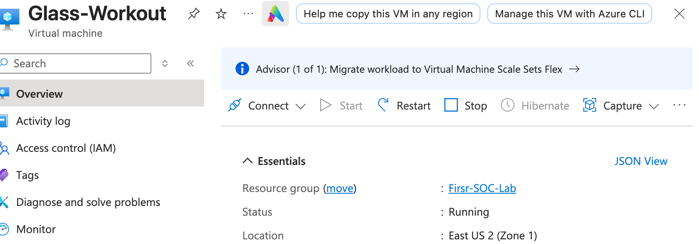
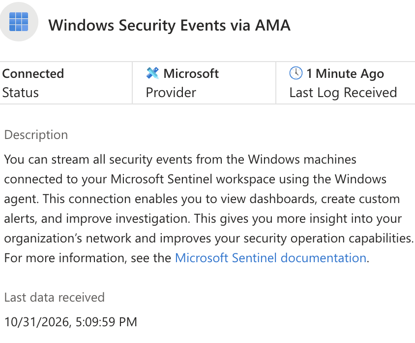
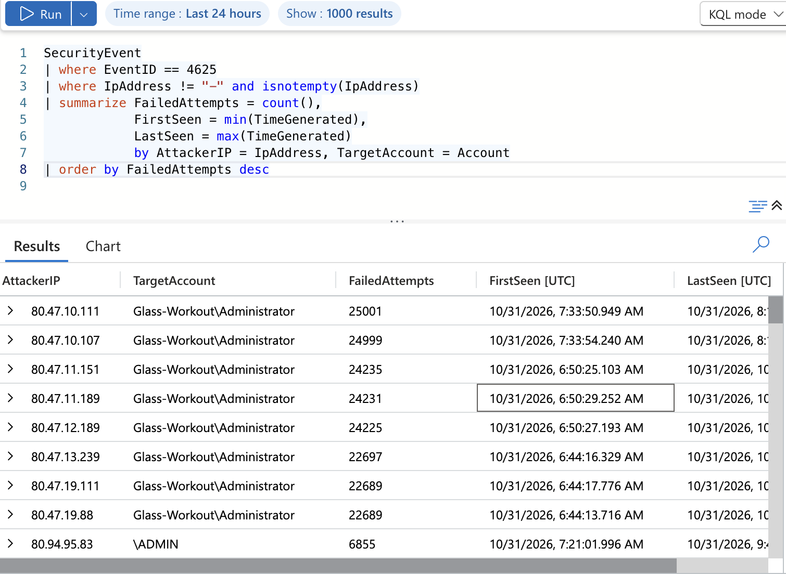
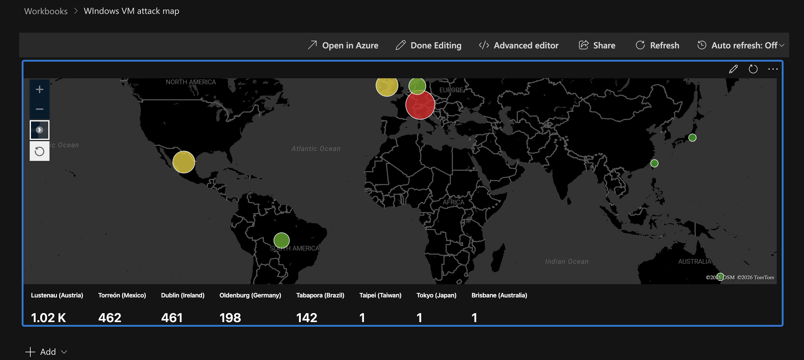

# Microsoft Sentinel SOC Home Lab

I wanted to see what a real attack looks like from the defender's side, so I built a cloud SIEM in Azure, put a Windows VM on the open internet, and analyzed what came up. After a couple hours of an open network, automated scanners were hammering it with brute-force logins. This repo documents how I set it up, how I analyzed the attacks with KQL, and how I mapped where they came from.

**Tools:** Microsoft Azure, Microsoft Sentinel, Log Analytics, Azure Monitor Agent, KQL, GitHub

## Key Findings
- **One source IP made about 25,000 failed logon attempts** against the built-in Administrator account in roughly 12 hours.
- Attackers cycled through common usernames such as "administrator", "admin","User',"Backup"
- Activity came from many countries, with the most geolocated attempts from Austria, Mexico and Ireland.
- Dozens of source IPs hit the VM, and several in the same address range showed nearly identical counts and start times, which suggests one coordinated source.

## How It's Built
- **Resource group, virtual network and subnet** hold the lab environment.
- **Windows 10 VM** with a network security group (firewall) deliberately open to the internet, so it acts as a honeypot.
- **Log Analytics workspace** acts as the central log repository.
- **Azure Monitor Agent** with a data collection rule forwards all Windows security events from the VM to the workspace, so I could analyze logs.
- **Microsoft Sentinel** is enabled on top of the workspace for querying and visualization.
- **GeoIP watchlist:** I uploaded a spreadsheet of IP blocks with location data into Sentinel so I could look up where each attacker IP originates.

## Walkthrough

### 1. The target VM

A Windows 10 VM in Azure East US 2, exposed to the internet on purpose.

### 2. Getting the logs into Sentinel

The Windows Security Events connector shows as connected, with logs arriving within a minute. This confirmed the agent and data collection rule were working.

### 3. Who is attacking, and what are they guessing?

I filtered for failed logons (Event ID 4625) and grouped them by source IP and targeted account. The results made the pattern obvious: a handful of IPs responsible for tens of thousands of attempts each, almost all against the Administrator account.

```kql
SecurityEvent
| where EventID == 4625
| where IpAddress != "-" and isnotempty(IpAddress)
| summarize FailedAttempts = count(),
            FirstSeen = min(TimeGenerated),
            LastSeen = max(TimeGenerated)
            by AttackerIP = IpAddress, TargetAccount = Account
| order by FailedAttempts desc
```

### 4. Where are they coming from?

I joined the failed logon events to the GeoIP watchlist with 'Ip4_lookup` and plotted the results on a Sentinel workbook map. Marker size and color Helped me understand the amount of attempts coming from each location. The workbook definition is saved in this repo.

## What I Learned
- How to filter, summarize and enrich log data with KQL, including joining logs to a watchlist.
- How data flows from an endpoint through an agent and data collection rule into Log Analytics and Sentinel.
- How fast an internet-exposed machine gets found: automated brute-force traffic started within hours and never let up.
- Why detection matters. Seeing 25,000 attempts from one IP made it clear that a threshold-based alert would catch this immediately.

## What I'd Add Next
- A scheduled analytics rule that alerts on repeated failed logons from a single IP, plus an automated response.
- Hardening the VM (restricting RDP, enabling account lockout) and measuring how the attack data changes.

## Notes
This lab was built for learning in an isolated Azure subscription. No real systems or data were involved.
